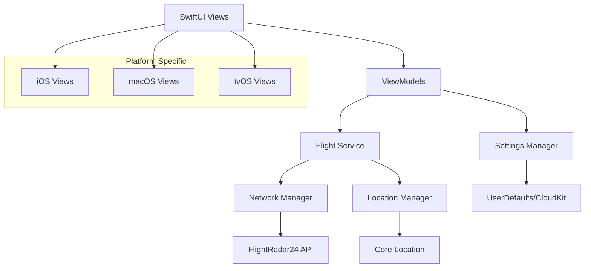

# Design Document

## Overview

The WhatTheFlight application will be built as a SwiftUI-based cross-platform application targeting iOS 17+, macOS 14+, and tvOS 17+. The application follows the MVVM (Model-View-ViewModel) architectural pattern with reactive data binding using Combine framework. The core functionality centers around periodic API polling of FlightRadar24 services to detect and display aircraft within user-defined geographic boundaries.

The application will maintain a clean separation between data models, business logic, and presentation layers, enabling code reuse across all three Apple platforms while providing platform-specific optimizations for user experience.

## Architecture

### High-Level Architecture



### Core Components

1. **Presentation Layer**: SwiftUI views with platform-specific adaptations
2. **Business Logic Layer**: ViewModels managing state and coordinating services
3. **Service Layer**: Specialized services for flight data, networking, and location
4. **Data Layer**: Models representing flight data and user preferences
5. **Platform Integration**: Core Location, CloudKit, and platform-specific APIs

## Components and Interfaces

### Data Models

#### FlightData
```swift
struct FlightData: Codable, Identifiable {
    let id: String
    let flightNumber: String?
    let callsign: String?
    let airline: AirlineInfo?
    let aircraft: AircraftInfo?
    let route: RouteInfo?
    let position: FlightPosition?
    let lastUpdated: Date
}

struct AirlineInfo: Codable {
    let name: String
    let code: String?
}

struct AircraftInfo: Codable {
    let model: String
    let code: String
    let registration: String?
}

struct RouteInfo: Codable {
    let origin: AirportInfo
    let destination: AirportInfo
}

struct AirportInfo: Codable {
    let name: String
    let iataCode: String
    let city: String?
}

struct FlightPosition: Codable {
    let latitude: Double
    let longitude: Double
    let altitude: Int?
    let speed: Int?
    let heading: Int?
}
```

#### GeographicBounds
```swift
struct GeographicBounds: Codable {
    let northLatitude: Double
    let southLatitude: Double
    let eastLongitude: Double
    let westLongitude: Double
    
    var isValid: Bool {
        return northLatitude > southLatitude && 
               eastLongitude > westLongitude &&
               abs(northLatitude) <= 90 && abs(southLatitude) <= 90 &&
               abs(eastLongitude) <= 180 && abs(westLongitude) <= 180
    }
}
```

### Service Layer

#### FlightService
Primary service responsible for flight data management and API coordination.

```swift
protocol FlightServiceProtocol {
    func startMonitoring(bounds: GeographicBounds)
    func stopMonitoring()
    func updateBounds(_ bounds: GeographicBounds)
    var currentFlights: Published<[FlightData]> { get }
    var connectionStatus: Published<ConnectionStatus> { get }
}

class FlightService: FlightServiceProtocol, ObservableObject {
    @Published var currentFlights: [FlightData] = []
    @Published var connectionStatus: ConnectionStatus = .disconnected
    
    private let networkManager: NetworkManagerProtocol
    private let settingsManager: SettingsManagerProtocol
    private var monitoringTimer: Timer?
    private var currentBounds: GeographicBounds?
}
```

#### NetworkManager
Handles all HTTP communication with FlightRadar24 APIs.

```swift
protocol NetworkManagerProtocol {
    func fetchFlightsInBounds(_ bounds: GeographicBounds) async throws -> [String: Any]
    func fetchFlightDetails(flightId: String) async throws -> [String: Any]
}

class NetworkManager: NetworkManagerProtocol {
    private let session: URLSession
    private let baseSearchURL = "https://data-cloud.flightradar24.com/zones/fcgi/feed.js"
    private let baseDetailsURL = "https://data-live.flightradar24.com/clickhandler/"
    
    private var requestHeaders: [String: String] = [
        "User-Agent": "Mozilla/5.0 (Macintosh; Intel Mac OS X 10_15_7) AppleWebKit/537.36",
        "Cache-Control": "no-store, no-cache, must-revalidate",
        "Accept": "application/json"
    ]
}
```

#### LocationManager
Manages user location services and geographic boundary validation.

```swift
protocol LocationManagerProtocol {
    func requestLocationPermission()
    func getCurrentLocation() async throws -> CLLocation
    var authorizationStatus: Published<CLAuthorizationStatus> { get }
}

class LocationManager: NSObject, LocationManagerProtocol, ObservableObject {
    @Published var authorizationStatus: CLAuthorizationStatus = .notDetermined
    private let locationManager = CLLocationManager()
}
```

### ViewModels

#### MainViewModel
Central ViewModel coordinating the main application state.

```swift
class MainViewModel: ObservableObject {
    @Published var flights: [FlightData] = []
    @Published var connectionStatus: ConnectionStatus = .disconnected
    @Published var isMonitoring: Bool = false
    @Published var currentBounds: GeographicBounds?
    
    private let flightService: FlightServiceProtocol
    private let settingsManager: SettingsManagerProtocol
    private let locationManager: LocationManagerProtocol
    private var cancellables = Set<AnyCancellable>()
}
```

#### SettingsViewModel
Manages user preferences and configuration.

```swift
class SettingsViewModel: ObservableObject {
    @Published var queryInterval: TimeInterval = 30
    @Published var geographicBounds: GeographicBounds?
    @Published var displayPreferences: DisplayPreferences
    @Published var notificationSettings: NotificationSettings
    
    private let settingsManager: SettingsManagerProtocol
}
```

### Aircraft Icon Layering System

#### Overlap Detection and Z-Index Management

The aircraft icon layering system will implement intelligent visual hierarchy management for overlapping perimeter aircraft icons. This system ensures that the most relevant aircraft (focused or closest) remain visible while providing visual feedback about overlapping aircraft through opacity adjustments.

```swift
struct AircraftIconLayer {
    let flight: FlightData
    let position: CGPoint
    let distance: Double
    let isFocused: Bool
    let zIndex: Int
    let opacity: Double
}

class IconLayeringManager: ObservableObject {
    @Published var layeredIcons: [AircraftIconLayer] = []
    
    func calculateLayering(
        flights: [FlightData], 
        positions: [String: CGPoint],
        distances: [String: Double],
        focusedFlightId: String?,
        screenSize: CGSize
    ) -> [AircraftIconLayer]
}
```

#### Layering Algorithm

1. **Overlap Detection**: Calculate bounding rectangles for each aircraft icon position and detect intersections
2. **Priority Assignment**: 
   - Focused aircraft receives highest priority (zIndex = 1000)
   - Non-focused overlapping aircraft sorted by distance (closest gets higher zIndex)
   - Non-overlapping aircraft maintain standard zIndex
3. **Opacity Calculation**:
   - Top-layer icons: 100% opacity
   - Overlapping lower-layer icons: 70% opacity
   - Non-overlapping icons: 100% opacity

#### SwiftUI Implementation Strategy

```swift
struct PerimeterAircraftView: View {
    // ... existing properties
    let layerInfo: AircraftIconLayer
    
    var body: some View {
        aircraftIcon
            .opacity(layerInfo.opacity)
            .zIndex(Double(layerInfo.zIndex))
    }
}
```

### Platform-Specific Views

#### iOS Implementation
- Touch-optimized controls with gesture support
- Adaptive layout for iPhone and iPad
- Support for both portrait and landscape orientations
- Integration with iOS-specific features like widgets and shortcuts

#### macOS Implementation
- Mouse and keyboard interaction patterns
- Resizable windows with minimum size constraints
- Menu bar integration for quick access
- Support for multiple windows

#### tvOS Implementation
- Focus-based navigation optimized for remote control
- Large text and high contrast for TV viewing distances
- Simplified interface with fewer interactive elements
- Integration with tvOS-specific features like Top Shelf

## Data Models

### Flight Data Processing Pipeline

1. **Raw API Response**: JSON data from FlightRadar24 APIs
2. **Parsing Layer**: Convert JSON to Swift structs with error handling
3. **Validation Layer**: Ensure data integrity and completeness
4. **Caching Layer**: Store recent flight data for offline viewing
5. **Presentation Layer**: Format data for UI display

### Data Persistence Strategy

- **User Preferences**: Stored in UserDefaults with CloudKit sync
- **Flight Cache**: In-memory storage with configurable retention
- **Location Settings**: Secure storage in Keychain if sensitive
- **App State**: Automatic state restoration using SwiftUI's state management

## Error Handling

### Network Error Handling

1. **Connection Failures**: Implement exponential backoff with maximum retry limits
2. **API Rate Limiting**: Respect rate limits and adjust query frequency dynamically
3. **Invalid Responses**: Graceful degradation with user-friendly error messages
4. **Timeout Handling**: Configurable timeout values with fallback mechanisms

### Data Validation

1. **Geographic Bounds**: Validate coordinate ranges and logical consistency
2. **Flight Data**: Handle missing or malformed flight information gracefully
3. **User Input**: Validate all user-provided configuration values
4. **API Schema Changes**: Robust parsing that handles API evolution

### User Experience Error Handling

1. **Offline Mode**: Clear indication of connectivity status
2. **Permission Denied**: Alternative workflows when location access is denied
3. **No Flights Found**: Informative messaging when no aircraft are detected
4. **Configuration Errors**: Guided setup flow for invalid settings

## Testing Strategy

### Unit Testing

- **Service Layer**: Mock network responses and test business logic
- **Data Models**: Validate parsing, encoding, and validation logic
- **ViewModels**: Test state management and user interaction flows
- **Utilities**: Test geographic calculations and data transformations

### Integration Testing

- **API Integration**: Test against live FlightRadar24 APIs with rate limiting
- **Location Services**: Test with various permission states and mock locations
- **Cross-Platform**: Validate consistent behavior across iOS, macOS, and tvOS
- **CloudKit Sync**: Test settings synchronization across devices

### UI Testing

- **Navigation Flows**: Automated testing of user interaction paths
- **Platform Adaptation**: Verify appropriate UI behavior on each platform
- **Accessibility**: Test VoiceOver, Dynamic Type, and other accessibility features
- **Performance**: Monitor memory usage and responsiveness during extended use

### Performance Testing

- **Memory Management**: Monitor for memory leaks during extended monitoring
- **Battery Usage**: Optimize for minimal battery drain on mobile devices
- **Network Efficiency**: Minimize API calls while maintaining data freshness
- **UI Responsiveness**: Ensure smooth animations and transitions

## Security Considerations

### API Security

- **Request Headers**: Use appropriate user agent strings to avoid blocking
- **Rate Limiting**: Implement client-side rate limiting to prevent API abuse
- **Error Handling**: Avoid exposing sensitive API details in error messages

### Data Privacy

- **Location Data**: Minimize location data retention and ensure user consent
- **Flight Information**: Handle publicly available flight data appropriately
- **User Preferences**: Secure storage of sensitive configuration data

### Network Security

- **HTTPS Only**: Enforce secure connections for all API communications
- **Certificate Validation**: Implement proper SSL certificate validation
- **Request Validation**: Validate all outgoing requests to prevent injection attacks